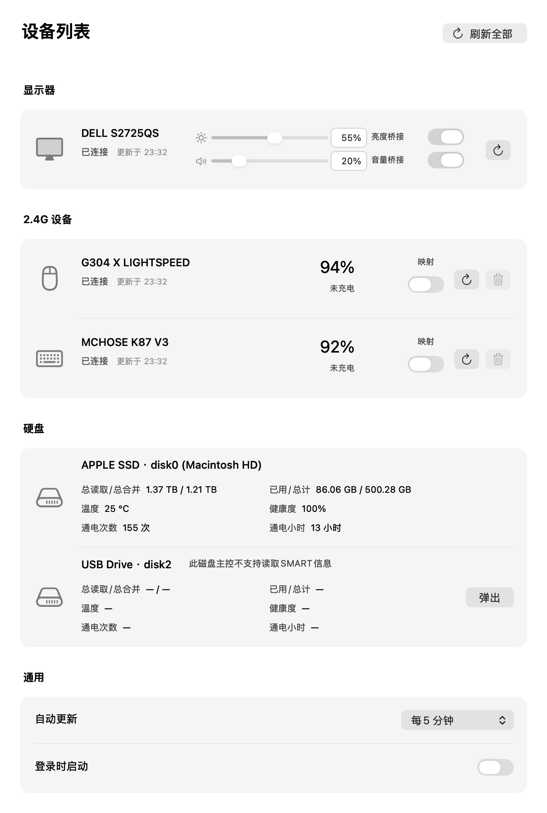
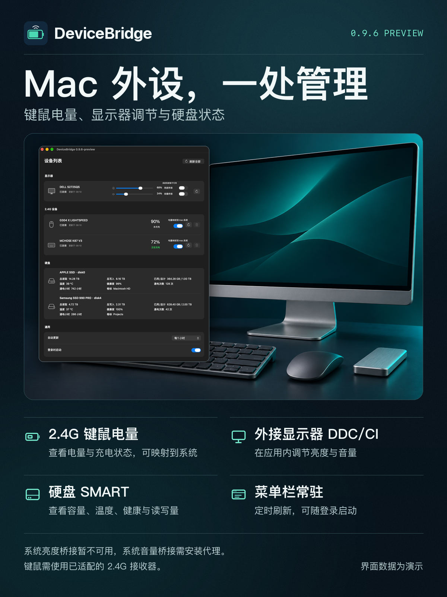

<p align="center"></p>

# DeviceBridge

**本项目纯粹为爱发电。** 希望让使用 Mac 的朋友更方便地查看 **2.4G 无线键鼠的电量**，以及通过 **DDC/CI 调节外接显示器的亮度和音量**，减少日常使用中来回打开驱动或操作显示器菜单的麻烦。

项目还不完美，目前处于 **0.9.6 Preview** 阶段，设备兼容性和部分功能仍在持续验证。键鼠电量仅支持已适配的 USB 2.4G 接收器，显示器调节则需要设备与连接链路支持 DDC/CI，具体范围见下文。

> **当前限制：外接显示器亮度尚未接入 macOS 原生系统控制。** 目前可在应用主界面通过 DDC 调节亮度，但不能通过系统原生亮度滑块控制；系统音量代理是独立功能，详情见下文。

欢迎通过 [Issue](https://github.com/zjyg1993/devicebridge/issues) 反馈问题、提交设备适配需求，也欢迎提交 PR，一起完善项目。

项目仓库：[zjyg1993/devicebridge](https://github.com/zjyg1993/devicebridge)。

## 1. 主要功能

DeviceBridge 是轻量的 macOS 原生菜单栏应用，提供无线外设电量桥接与外接显示器 DDC 控制。

- **多品牌 2.4G 协议**：覆盖罗技、雷蛇、华硕 ROG、迈从、Pulsar、ATK / VXE、Corsair、LAMZU、WLmouse 等指定接收器；本轮按截至 2026-11-16 的公开产品及协议资料补充新款设备，具体范围见下表。
- **查看外设电量**：在设备列表中查看电量、连接状态和设备支持的充电状态。
- **接入系统电池组件**：按设备开启映射，将有效电量发布到 macOS 外设电源列表；组件是否展示、刷新时机与图标由系统决定。
- **自动更新与手动刷新**：支持 5 分钟、30 分钟、1 小时、2 小时、3 小时更新周期，也可单独刷新设备；无有效读数时不显示为 0%。
- **外接显示器控制（预览）**：扫描时自动读取型号，分别探测 DDC 硬件亮度、扬声器音量，在主界面提供亮度 / 音量滑块及独立桥接开关，插拔与唤醒后自动重查。当前亮度桥接不可用，音量桥接需安装系统音量代理并满足输出匹配条件，详情见下文。
- **查看硬盘**：在 2.4G 设备下方查看物理硬盘的总读取、总写入、已用/总计、温度、健康度、通电次数和通电小时。硬盘接入、移除及卷挂载状态变化后会自动更新列表，平时按全局自动更新周期读取。容量由 macOS 的 `diskutil` 提供。SMART 数据由 App 内置的 smartmontools 7.5 读取，实际可读字段取决于硬盘、连接方式和访问权限。界面以「—」表示不可读取，以「≥」表示只统计了可读取的分区。
- **分类与整页滚动**：显示器独立分组并优先显示，2.4G 设备单独列出；从顶部标题到通用设置使用同一个滚动区域。
- **状态栏入口**：通过菜单栏打开主界面或退出程序；设备状态查看、亮度与音量调节集中在主界面。
- **后台常驻**：支持登录时启动，关闭主窗口后继续运行，通过菜单栏管理和退出。
- **本地独立运行**：无需保持网页驱动或官方客户端运行，无需 Python、Node.js；不上传设备状态，不记录按键输入。

本工具不替代官方驱动的 DPI、按键、宏、灯效、配对或固件管理功能。

### 使用截图

**主界面：统一查看设备状态、设置电量映射，并调节显示器亮度与音量。**

<p align="center"></p>

**状态栏菜单：仅保留“显示主界面”和“退出程序”。以下为旧版菜单截图。**

<p align="center"></p>

截图来自 0.8.2 的历史 AppKit 界面，设备和数值为文档演示数据；当前版本的设备列表和调节滑块仅在主界面显示。历史截图不表示已接入 macOS 原生控制中心。

<details>
<summary>查看宣传海报</summary>

<p align="center"></p>

</details>


## 2. 支持设备及型号

键鼠电量功能仅适用于已适配的 **USB 2.4G 接收器连接**。蓝牙、普通有线 USB 设备及未适配的接收器不在当前支持范围内。

| 品牌 | 型号 / 设备族 | 支持状态 |
| --- | --- | --- |
| Logitech / 罗技 | **G304 X LIGHTSPEED** | 已在本机读取电量并发布到系统电源列表 |
| MCHOSE / 迈从 | **K87 V3** | 已在本机读取电量并发布到系统电源列表 |
| XUNSHE / YJX | **USB Receiver（YJX）**，接收器 `A8A5:2255` | 实验性适配；此前版本已实测读取并发布电量，当前版本尚未重新实机验证；具体硬件型号未确认 |
| AULA / 狼蛛 | **F75**，接收器 `3554:FA09` | 预览适配，尚未实机验证；不包含 Max / Pro 等变体 |
| AULA / 狼蛛 | **SC580（3311 / 3315 传感器版）**，接收器 `089D:062F` | 预览适配，尚未实机验证；不包含 SE / Pro / Max 等变体 |
| Razer / 雷蛇 | **BlackWidow V3 Pro、V3 Mini HyperSpeed、V4 Mini HyperSpeed、V4 Tenkeyless HyperSpeed；DeathStalker V2 Pro / TKL** | 新增只读电量及充电状态，预览适配，尚未实机验证 |
| Razer / 雷蛇 | **Viper V2 / V3 / V4 Pro、Viper Mini Signature Edition；DeathAdder V3 Pro / V3 HyperSpeed / V4 Pro（含 Carbon Fiber）；Basilisk V3 Pro / 35K（含 Phantom Green）；Cobra Pro** | 新增指定 2.4G 接收器电量及充电状态，预览适配，尚未实机验证 |
| SteelSeries / 赛睿 | **Aerox 3 Wireless（含 CS2 Dragon Lore）、Aerox 5 Wireless（含 Destiny 2 / Diablo IV）、Aerox 9 Wireless（含 WoW）** | 新增接收器查询，5% 档位电量及充电标记；预览适配，尚未实机验证；不含 Gen 2 |
| Keychron | **M5、M6 8K，经 Ultra-Link 8K 接收器 `3434:D028`** | 新增电量及充电状态；显示设备族名称，预览适配，尚未实机验证 |
| Glorious | **Model O Wireless**，接收器 `258A:2022` | 新增在线电量查询，预览适配，尚未实机验证；充电离开无线链路时不提供当前读数 |
| ASUS ROG | **Harpe II Ace / Harpe II Extreme**，专用 SpeedNova 8K 接收器 `0B05:1AD0` | 新增指定接收器电量及充电查询，预览适配，尚未实机验证 |
| ASUS ROG | **Azoth、Azoth Extreme / Special Edition、Azoth 96 HE / Lite、Azoth X、Falcata、Strix Scope II 96 Wireless、Strix Morph 96 Wireless**，经 **OMNI 接收器 `0B05:1ACE`** | 新增配对型号识别与键盘电量路由，预览适配；仅命中已知配对型号才查询，尚未实机验证；不等同于各型号专用接收器均兼容 |
| MCHOSE / 迈从 | **A7 V2 Ultra**；**L7 / M7 接收器族（含 L7 Pro、M7 Ultra）**；**A5 Pro Max 1K / 4K 接收器** | 新增两类协议；共享接收器显示设备族，预览适配，尚未实机验证 |
| Pulsar | **X2 CrazyLight Mini**；**X2 V2 / X2H / X2A / Xlite V3 的指定 1K / 4K 接收器族** | 新增在线状态与电量查询，预览适配；不代表所有 CrazyLight 尺寸、SKU 均兼容，尚未实机验证 |
| ATK / VXE / VGN | **ATK X1 Pro 1K、Fire X 8K、VXE R1 SE+、R1 Pro Max、VGN Dragonfly 4K 接收器** | 新增 Compx 只读查询，预览适配，尚未实机验证 |
| ATK | **V75X 键盘**，`320F:5088` 且产品名 `ATK V75X 2.4G Dongle` | 新增键盘电量与充电状态，校验请求序号，预览适配，尚未实机验证 |
| Corsair | **SABRE v2 PRO ULTRALIGHT**，接收器 `1B1C:2B2A` | 新增 Compx 接收器协议，预览适配，尚未实机验证；不扩展到其他 iCUE / SLIPSTREAM 设备 |
| LAMZU / WLmouse | **Maya X 8K；Beast X、Beast X Max、Beast X Mini Pro** | 新增指定接收器 Feature 电量查询，预览适配，尚未实机验证 |
| Hitscan / Teevolution | **Hyperlight / Terra Pro** 的指定接收器 | 新增在线状态及电量查询，预览适配，尚未实机验证 |
| Logitech / 罗技 | **PRO X2 SUPERSTRIKE**，接收器 `046D:C54D` | 新增不依赖产品名的 HID++ 接收器识别入口；电量功能仍需实际探测与实机验证，尚不承诺兼容 |
| Logitech / 罗技 | 部分支持 HID++ 2.0 电量功能 `0x1000 / 0x1004` 的键鼠 | 已实现通用探测，需逐设备验证 USB 接收器链路 |


### 外接显示器

| 设备 | 支持状态 |
| --- | --- |
| 支持通用 DDC 控制的显示器 | 按实际 VCP 响应分别探测亮度 `0x10`、音量 `0x62`；无需型号白名单，连接链路须支持 DDC |

状态栏菜单仅保留“显示主界面”和“退出程序”；亮度、音量调节集中在主界面，滑条随窗口宽度加长。

当前本地构建缺少 Apple 授权的虚拟 HID 签名，因此亮度桥接开关置灰并显示原因；开启偏好不会被误报为系统亮度已接通，应用内 DDC 调节可独立使用。

### 显示器独立桥接开关（0.8.19）

显示器行分别提供“亮度桥接”和“音量桥接”，独立保存、独立生效。关闭亮度桥接不停止音频代理，关闭音量桥接不停止亮度控制。

音量桥接仅在能唯一匹配在线 HDMI / DisplayPort 音频输出时可用；没有音频输出或同名多屏无法确定归属时置灰。不会仅凭 DDC 音量读数认为显示器具有音频。

从状态栏点一次「退出程序」，DeviceBridge 会先将音频切回启用代理前的输出，再从系统输出列表撤下 Proxy Audio Device，确认后自动退出。若已手动切到其他输出，会保留当前选择。驱动保留安装，下次启动并启用音量桥接后重新注册。关闭所有音量桥接时也会撤下代理。恢复失败则暂缓退出，避免留下无效输出。强制结束进程无法保证执行清理。

### 系统音量代理（0.8.19）

首次打开应用会自动提示安装音量代理，无需寻找手动安装或“系统音量”按钮。已有 DeviceBridge 设置的升级用户同样会进入这项新功能的初始化流程。

1. 在自动弹出的提示中选择“继续安装…”，按 macOS 提示进行管理员授权。安装会短暂重启音频服务，中断当前播放；已有驱动不会被覆盖。
2. 安装完成后自动等待 Core Audio 加载，并连接当前显示器音频输出；多个显示器且当前输出无法确定时会弹出选择框。
3. 播放声音，验证系统音量和静音。系统滑块调节软件音量，显示器 OSD 音量保持原值；OSD 音量为 0 时仍不会出声。


## 3. 系统要求

| 项目 | 要求 |
| --- | --- |
| macOS | 最低构建目标为 macOS 13；当前验证环境为 macOS 27，其他版本待验证 |
| 处理器 | 包含 Apple Silicon（arm64）与 Intel（x86_64）通用二进制；Intel 实机待验证 |
| 外设 | 上述 2.4G 键鼠，或启用 DDC/CI 且连接链路支持 DDC 的外接显示器 |
| 权限 | 按系统提示允许输入监控；显示器媒体键转发需辅助功能权限；登录时启动可能需要批准登录项 |

打开 `DeviceBridge-0.9.6-preview.dmg`，将应用拖入 **应用程序**，再从访达启动。需要授权时，前往 **系统设置 → 隐私与安全性 → 输入监控** 允许 DeviceBridge，并按提示退出重开；随后开启设备行右侧的 **映射开关**，即可尝试接入系统电池组件。

预览版使用 ad-hoc 本地签名，尚未经过 Apple 公证，首次启动或更新后可能需要系统确认或重新授权。无需关闭 SIP 或安装内核扩展。系统电量发布使用 IOKit 私有 SPI，后续 macOS 更新可能影响兼容性。

已完成快捷键授权引导的安装在升级后会跳过该引导。若系统仍要求授权，可通过应用内的授权按钮重新开启。持续发布时，可用已安装的 Developer ID Application 签名身份运行 `DEVICEBRIDGE_SIGN_IDENTITY='签名身份名称' ./release.sh`，并在后续版本中沿用兼容的签名身份。首次从 ad-hoc 切换到证书签名仍可能需要重新授权。虚拟 HID 亮度桥接另需 Apple 签发的描述文件。

### 首次安装或更新后的快捷启动命令

将 App 拖入「应用程序」后，如果 macOS 提示「无法验证开发者」或因下载隔离而阻止打开，确认安装包来源可信后，在「终端」执行：

```sh
xattr -dr com.apple.quarantine "/Applications/DeviceBridge.app"
open "/Applications/DeviceBridge.app"
```

使用显示器调节功能前，请先在显示器的 OSD 菜单中打开 **DDC/CI**。

## 4. 参考资料

- [ddcutil MCCS / VCP 功能说明](https://www.ddcutil.com/vcpinfo_output/)
- [MonitorControl：Apple Silicon DDC 实现与兼容性](https://github.com/MonitorControl/MonitorControl)
- [m1ddc：IOAVService DDC 工具](https://github.com/waydabber/m1ddc)
- [Logitech 官方 HID++ 2.0 文档](https://github.com/Logitech/cpg-docs/blob/master/hidpp20/README.rst)
- [Razer Viper V4 Pro 官方发布](https://www.razer.com/newsroom/product-news/viper-v4-pro-gigantus-v2-pro)
- [Corsair SABRE v2 PRO ULTRALIGHT 官方产品](https://www.corsair.com/ww/en/p/gaming-mouse/ch-931g000-ww/sabre-v2-pro-ultralight-wireless-gaming-mouse-ch-931g000-ww)
- [Pulsar 当前驱动与固件](https://www.pulsar.gg/pages/download)
- [MCHOSE 协议文档](https://github.com/alexfrih/mchose-linux/blob/main/PROTOCOL.md)
- [Pulsar / Compx 原始协议实现](https://github.com/andrewrabert/python-pulsar-mouse-tool)
- [G-Helper：ROG 外设实现](https://github.com/seerge/g-helper)
- [OpenRazer：雷蛇键鼠协议与设备目录](https://github.com/openrazer/openrazer)
- [Rivalcfg：赛睿设备与无线接收器目录](https://rivalcfg.flozz.org/devices.html)
- [alloyctl：Aerox 3 Wireless 协议](https://alloy.szymon-wilczek.me/protocol/steelseries-aerox3-wireless.html)
- [Keychron 电量协议实现](https://github.com/csutcliff/keychron-battery-dkms)
- [HaloBattery：多品牌电量协议记录（含 Glorious）](https://github.com/HeyOkay/HaloBattery/blob/main/docs/protocols.md)
- [Solaar：Logitech 设备协议与社区兼容性记录](https://github.com/pwr-Solaar/Solaar)
- [MCHOSE 官方 M HUB 说明](https://support.mchose.store/hc/en-us/articles/49078340935700-Getting-Started-with-MCHOSE-M-HUB)
- [MCHOSE 官方网页驱动](https://www.mchose.com.cn/)
- [XUNSHE 官方网页驱动](https://xunshe.yjx2012.com/?productName=USB%20Receiver)
- [YJX F0 主动电量查询实现](https://github.com/mimuruu/EWEADN-GS02-Pro-Control)
- [YJX 不同固件报文记录](https://github.com/HeyOkay/HaloBattery/blob/main/docs/protocols.md)
